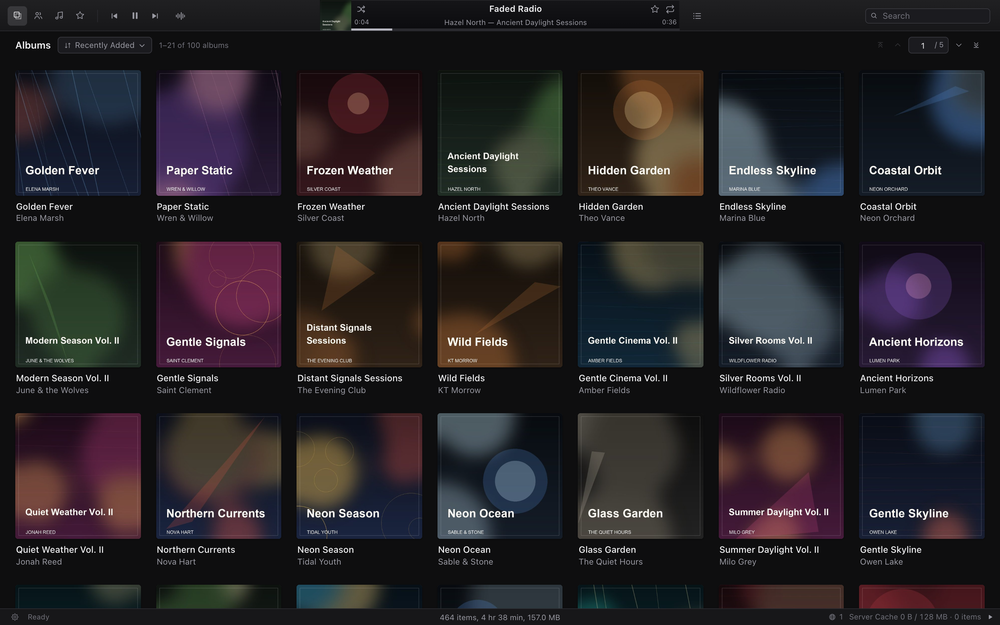

# WebTracks

A local-first web music player. The backend is Python and uses a SQLite schema
compatible with [`../tracks`](../tracks) (the macOS SwiftUI Tracks app), but the
database and artwork cache are generated by this project inside its own `data/`
directory. It never reads or writes the native app's database or cache.

The frontend is plain HTML/CSS/JavaScript with no CDN, external fonts, or remote
images. The current UI is dark and mirrors the structure of the Tracks Library
window: a 45pt player bar, icon-only section tabs at the top, an album grid /
album detail view, a Songs table, an Artists browser, a playlist overview, a
queue overlay, and a 24pt status bar.



## Features

- Plays FLAC / MP3 / M4A / WAV / AIFF / OGG / Opus, with HTTP Range seeking.
- macOS Now Playing and Control Center integration through the Media Session
  API: title, artist, album, cover art, progress, plus previous / next /
  play / pause / seek actions from the media keys. Browsers only expose this
  on localhost or HTTPS; plain HTTP on a LAN address is not a secure context.
- Quality selection: the waveform button in the toolbar opens a menu built from
  the `audio_formats` list in `config.yaml`. The default is AAC · 128 kbps,
  transcoded and streamed live by ffmpeg; add other AAC bitrates or a `raw`
  entry for the original file. Transcode output goes into a shared in-memory
  cache (512 MB by default); all qualities share the same capacity. Entries
  stay for the process lifetime and are cleared only when a new item would
  overflow the budget. Transcodes contain only the audio stream: artwork,
  chapters, and source tags are stripped before transmission.
- Opens in the Albums view with an album grid, album detail, Songs table,
  Artists, and a Playlists overview containing Stared and user playlists. The
  Genres view is kept in the code but has no visible entry point.
- Album sorting: Recently Added / Album Name / Artist / Year; the sort menu
  separates the Ascending / Descending choice with a divider at the bottom.
  The default comes from `album_sort` and `album_sort_descending` in
  `config.yaml`, currently recently added, descending.
- The album grid is virtualized: only visible rows are kept in the DOM, with
  native lazy loading for artwork, so large libraries scroll smoothly in Safari.
  Paging is virtual: the page count is derived from the current column count and
  visible row count, and first / previous / next / last (arrow buttons) or a page
  number scrolls to that page. Searches and sorts return to page 1.
- Built-in **Stared** playlist (backed by `songs.loved`) and user playlists.
- Song stars and play counts are written to the project's own Tracks-compatible
  database. A play is counted when a new audio playback session requests the
  stream; repeated Range requests for one playback are counted once, and the
  same song is counted at most once per 30 seconds per source IP.
- Public song payloads omit tag comments, last-played timestamps, and skip
  counts; those values remain in `library.sqlite` for compatibility.
- Play queue: Up Next / History, Play Next, Play Later, Shuffle, Repeat.
- The queue and playback position are stored in browser `localStorage` and
  restored paused after a reload.
- Search, album sorting (Recently Added / Album Name / Artist / Year), and
  keyboard shortcuts.
- Hash-based deep links for albums, songs, playlists, and artists; the copy
  link actions build the full URL from the current scheme, host, and app base
  path.
- Status bar: Setup gear, Ready/Scanning/ReKeying progress, online client count
  (globe icon), **Server Cache** usage, and playback state.
- Database and artwork cache generation from both the command line and the
  in-page **Setup** panel. Setup requires the admin password and offers Quick
  Scan, Full Scan, ReKey, URL ID format / default sort selection, and admin
  password changes; it can only operate on libraries already stored in the
  database.
- Daily runtime and operation logs under `logs/`; archives are gzip-compressed
  at midnight.
- Per-IP audio download limiting (28 distinct items per minute by default);
  repeated Range requests for one song count once and the UI stays silent when
  the limit is reached.
- Audio and artwork responses use `Cross-Origin-Resource-Policy: same-origin`,
  and state-changing requests reject a mismatched `Origin` or cross-site
  `Sec-Fetch-Site`.
- In-memory usage statistics: the six summary counters are visible in Setup
  without logging in, while per-IP details with current online status,
  transferred bytes, songs played, playlist actions, scans/ReKey/
  artwork jobs, rate-limit events, and blocked brute-force logins appear after
  admin login. The per-IP table keeps only the 50 most recently active
  addresses; aggregate request and byte counters still include every request.
  Presence is keyed by source IP, so multiple tabs on one machine count once.
  Statistics reset when the server restarts.
- All frontend assets live under `static/`; there are no CDN requests.

## Requirements

- Python 3.9+
- `Flask`, `Pillow`, `PyYAML` (see `requirements.txt`)
- `ffmpeg` / `ffprobe`
  - FLAC is read entirely in Python and does not need ffmpeg.
  - Tags and artwork for MP3 / M4A / WAV / AIFF / OGG / Opus are read through
    ffprobe/ffmpeg.
  - Configured AAC qualities are transcoded live by ffmpeg, so a working
    ffmpeg is needed when using a transcoded format.

```bash
python3 -m venv .venv
.venv/bin/pip install -r requirements.txt
```

On macOS, ffmpeg can be installed with Homebrew:

```bash
brew install ffmpeg
```

## Running the player

By default the database and artwork cache live inside the project directory,
completely separate from macOS Tracks:

- Config: `config.yaml` (created automatically on first run; a complete
  template is tracked as `config.example.yaml`)
- Database: `data/library.sqlite`
- Artwork cache: `data/Artwork/`

It never reads or writes `~/Music/Tracks/library.sqlite` and never uses
`~/Library/Caches/com.audia.tracks/Artwork`.

```bash
python3 server.py
```

Open <http://127.0.0.1:8765> (or the host and port set in `config.yaml`).

### Configuration file

`config.yaml` contains application settings only. Music folders, library IDs,
and namespaces all live in `library.sqlite`, as in the macOS Tracks app.

The repository tracks a complete commented template at `config.example.yaml`.
Copy it before editing:

```bash
cp config.example.yaml config.yaml
```

`config.yaml` is ignored by git, so your local paths, host/port, and password
hash are never committed. If the file is missing, the server creates it with
the built-in defaults on first run.

| Key | Description |
| --- | --- |
| `database_dir` | Directory for the database and artwork cache. Relative paths are resolved against the directory containing `config.yaml`. The database is always `library.sqlite`, and artwork goes in the `Artwork/` subdirectory. |
| `host` / `port` | Listen address, default `127.0.0.1:8765`. Set `host: 0.0.0.0` for LAN access. |
| `server_header` | Value of the `Server` HTTP response header. Empty (default) omits the header; set a custom string if you want one. |
| `trusted_hosts` | Host header allowlist. `"*"` (default) accepts any Host; set exact hostnames to reduce DNS rebinding risk when the service is exposed through a proxy. |
| `read_only` | When `true`, all database writes are blocked: stars, play counts, playlist changes, scans, and ReKey. Playback, streaming, and browsing still work. |
| `jpeg_quality` | Album art cache JPEG quality, 15–100, default 80. |
| `cover_size` | Maximum album art cache width/height in pixels, 16–2000, default 500. |
| `transcode_cache_mb` | Transcode cache limit in MiB, shared across all qualities, default 512. `0` transcodes without retaining output. |
| `audio_formats` | Ordered list of streaming formats. Each entry has `index`, `format` (`aac` or `raw`), and, for AAC, `bitrate`. The example enables only `{"index": 0, "format": "aac", "bitrate": 128}`; add `{"index": 1, "format": "aac", "bitrate": 96}` or `{"index": 2, "format": "raw"}` for more choices. |
| `default_audio_format` | Index from `audio_formats` used when the player has no saved selection; default `0` (AAC 128 kbps). |
| `album_sort` | Default Albums sort: `recentlyAdded`, `album`, `artist`, or `year`; defaults to `recentlyAdded`. |
| `album_sort_descending` | Whether the default sort is descending; defaults to `true` (recently added first). |
| `admin_password_sha1` | SHA-1 of the Setup admin password (40 hex characters). Prefer changing it from **Setup → Admin**. The development default is the single digit `1`, which hashes to `356a192b7913b04c54574d18c28d46e6395428ab`. |
| `admin_bruteforce_limit` | Failed admin logins allowed per source IP inside the window before locking; default `5`. The next failure locks the IP. Set to `0` to disable brute-force protection. |
| `admin_bruteforce_window_seconds` | Rolling failure window in seconds; default `60`. |
| `admin_bruteforce_lock_seconds` | Lock duration in seconds; default `86400` (24 hours). Lock state is in memory and resets on restart. |
| `logs_dir` | Directory for `runtime.log` and `operations.log`; default `logs`, relative to `config.yaml`. |
| `log_level` | Runtime log threshold (`DEBUG`, `INFO`, `WARNING`, `ERROR`, or `CRITICAL`); default `INFO`. The operation log always records at `INFO`. |
| `log_format` | Format for both log files: `text` (default) or `json`. Text uses timestamped human-readable lines; JSON writes one object per line. |
| `rate_limit` | Maximum distinct audio items downloaded per source IP in a rolling 60-second window; default `28`. Repeated Range requests for the same song count once. Set to `0` to disable. |
| `url_id_format` | How album, song, and playlist links are displayed: `uuid` or `base64url`; default `uuid`. Can also be changed from **Setup → Settings**. |

Library IDs and namespaces are **not** configuration values. They live in the
`libraries` table of `library.sqlite`, matching the macOS Tracks app:

- `identifier` is the source string used by the next ReKey;
- `id_namespace` is the frozen namespace snapshot used to derive song UUIDs.

Legacy `libraries` or `music_dirs` sections are imported into the database once
so existing configs keep working; they are no longer required. Legacy
`identifier` and `namespace` keys are ignored. Library metadata is never written
back to `config.yaml`.

The library ID can be changed from **Setup** using the **Change ID** button
next to a library. This updates the database only and keeps the current
namespace; run **ReKey Database** afterwards to calculate the new namespace and
song UUIDs.
ReKey writes the new namespace back to the database, never to `config.yaml`.

The transcode cache is an in-process cache keyed by song ID, quality, source
file path, mtime, and size. Each configured AAC quality keeps its own entries
while sharing one capacity limit; `raw` entries bypass the cache. Entries are
retained for the lifetime of the process; when a new item cannot fit, the whole
cache is cleared and the new item is retained. The cache never writes into
`data/` and is naturally cleared when the server restarts. The status bar shows
total usage and entry count, and hovering reveals a per-quality breakdown.

Transcoded responses contain one audio stream only. The encoder drops attached
artwork, video/subtitle/data streams, chapters, and all source metadata tags;
bitexact flags also prevent the muxer from writing encoder/version tags.

Paths may use `~`. Command-line arguments take precedence over the config file:

```bash
python3 server.py \
  --database /path/to/library.sqlite \
  --artwork  /path/to/Artwork \
  --host 0.0.0.0 \
  --port 8780 \
  --transcode-cache-mb 512
```

Environment variables can override as well:

```bash
export WEBTRACKS_CONFIG="$HOME/Documents/ws/webtracks/config.yaml"
export WEBTRACKS_DATABASE_DIR="$HOME/Music/webtracks-data"
export WEBTRACKS_DB="/path/to/library.sqlite"
export WEBTRACKS_ARTWORK="/path/to/Artwork"
export WEBTRACKS_READ_ONLY=1
export WEBTRACKS_TRANSCODE_CACHE_MB=1024
export WEBTRACKS_ALBUM_SORT=recentlyAdded
export WEBTRACKS_ALBUM_SORT_DESCENDING=1
export WEBTRACKS_ADMIN_PASSWORD_SHA1=356a192b7913b04c54574d18c28d46e6395428ab
export WEBTRACKS_LOG_FORMAT=text
export WEBTRACKS_RATE_LIMIT=28
export WEBTRACKS_COVER_SIZE=500
export WEBTRACKS_JPEG_QUALITY=80
export WEBTRACKS_ADMIN_BRUTEFORCE_LIMIT=5
export WEBTRACKS_ADMIN_BRUTEFORCE_WINDOW_SECONDS=60
export WEBTRACKS_ADMIN_BRUTEFORCE_LOCK_SECONDS=86400
```

Read-only mode:

```bash
python3 server.py --read-only
```

> The current configuration listens on all interfaces for LAN access. The Setup
> password is only a local admin guard; HTTP itself is unencrypted. Do not
> expose the server to untrusted networks.

## Generating the database and artwork cache

The database and artwork cache are entirely generated by this project, in the
location given by `database_dir` in `config.yaml`. The first start or an `init`
run creates an empty database and the `Artwork/` directory.

### Initializing an empty database

```bash
python3 server.py init
```

Sample output:

```text
database: /path/to/webtracks/data/library.sqlite
artwork:  /path/to/webtracks/data/Artwork
```

### Scanning music folders

Music folder paths are stored in the `libraries` table of `library.sqlite`.
Add a folder (or refresh an existing one) with:

```bash
python3 server.py scan \
  --root "/Users/me/Music" \
  --identifier mymusic \
  --force
```

The first scan creates the library row with the given `identifier` and a matching
namespace. Later scans reuse the existing row; omit `--root` to scan every
enabled library already in the database:

```bash
python3 server.py scan --force
```

Options:

| Option | Description |
| --- | --- |
| `--root PATH` | Add or refresh one music folder. When omitted, every enabled library in the database is scanned. |
| `--identifier NAME` | Identifier used when `--root` creates a new library. Existing libraries keep their identifier. Defaults to `library1`, `library2`, and so on. |
| `--mode quick/full` | `quick` only discovers new files; `full` re-reads files whose mtime or size changed. Defaults to `quick`. |
| `--force` | Ignores the mtime/size cache, re-reads every file, and rewrites the artwork cache. |
| `--prune` | Deletes song rows that belong to the library but no longer exist on disk. |
| `--jpeg-quality N` | Artwork JPEG quality, 15–100, default 80. |
| `--cover-size N` | Maximum artwork cache width/height, 16–2000, default 500. |
| `--config PATH` | Config file to use; defaults to `config.yaml` next to `server.py`. |

Incremental scan:

```bash
python3 server.py scan --mode full
```

If the database does not exist, the full schema is created automatically. If it
does, only the index is updated; audio files are never modified.

### In-page Setup

Click the gear at the bottom left of the status bar to open **Setup**. Adding
libraries, changing their location, scanning, and ReKey require signing in first:

- Password field: `Enter admin password`
- Only the SHA-1 of the password is stored, in `admin_password_sha1`
- The development password is `1`
- Per-IP brute-force protection: by default the 6th failed login within a
  minute locks that IP for 24 hours. Locked requests always receive the same
  generic “Incorrect admin password” response, even with the correct password.
  Locks and failure counters are in memory only
- While signed out, library folders, action buttons, and settings are hidden or
  greyed out
- Scan, ReKey, and artwork progress is visible while signed out, but file paths,
  error details, and result summaries require admin login
- **Usage statistics** sits above the bottom **Admin** section. Logged-out
  visitors see the six summary counters; admin login reveals the per-client
  table and maintenance counters
- The bottom **Admin** section contains login/logout and password changes

Once signed in you can:

- **Add Library**: enter a folder path on the server (absolute, or starting
  with `~`) and optionally a library identifier. The folder is indexed
  read-only, must not overlap an existing library, and a Quick Scan starts
  immediately;
- **Disable / Enable Library**: hide a library's songs from the player and
  scans without deleting its index. Disabling stops playback and clears the
  queue and history; enabling starts a Quick Scan;
- **Delete**: only available for a disabled library. This removes its
  indexed songs, stars, play counts, and playlist entries but keeps audio files
  and user-created playlists; a timestamped SQLite backup is written first;
- **Change Location**: re-root an existing library. Songs are matched by their
  relative paths, stars, play counts, playlists, and IDs are preserved, and a
  timestamped SQLite backup is written first. Missing files stay indexed until
  a prune scan removes them;
- **Quick Scan**: scan the configured directories for new files;
- **Full Scan**: re-read every file and rebuild metadata and the artwork cache;
- **Rebuild Artwork**: re-extract every album cover using the current
  `cover_size` and `jpeg_quality` without rescanning the database;
- **Change ID**: edit a library's `identifier` from the **Change ID** button.
  The current namespace stays in the database until ReKey runs;
- **ReKey Database**: recompute all song, album, and artist IDs while preserving
  stars, play counts, playlists, and dates. The current namespace is recalculated
  from each database identifier and stored back in the database. A SQLite backup
  is written automatically first, and the page must be reloaded afterwards;
- **Settings → URL ID format**: display copied album, song, and playlist links
  as UUIDs or URL-safe Base64;
- **Settings → Default album sort / Sort order**: choose Recently Added, Album
  Name, Artist, or Year, and Ascending or Descending for new player sessions;
- **Settings → Artwork Cache Size / JPEG quality**: set the album art cache dimensions
  and JPEG quality. Use **Rebuild Artwork** or the next Full Scan to rebuild
  existing covers; and
- **Admin → Change Password**: button next to Log Out; replace the admin
  password. The new SHA-1 is written to `config.yaml`, every admin token is
  revoked, and you must log in again with the new password.

The Setup library list shows each library's ID with its current namespace in
grey. Disabled libraries stay in the list with an **Enable** button and can be
deleted after disabling. The music folder path is only shown after signing in.
Adding libraries, changing their location, disabling/enabling them, and deleting
their index are admin-only actions; all run against folders on the server
machine. The backend only scans enabled libraries already stored in the
database. Scans run in a background thread, the Setup window shows progress, and
the library refreshes automatically when a scan finishes.

You can still generate a password hash manually:

```bash
printf 'your-password' | shasum -a 1
```

Put the resulting 40-character hex string into `admin_password_sha1`.

### Logging

Two log files are written under `logs_dir`:

- `runtime.log` records startup, scan, ReKey, and server errors. Its threshold is
  `log_level` (default `INFO`).
- `operations.log` records admin and library operations. `remoteIp` is the
  client IP resolved from `CF-Connecting-IP` (Cloudflare Tunnel), then
  `X-Forwarded-For` (the leftmost valid entry), then `X-Real-IP`, then the
  direct socket peer. `proxyIp` records the direct peer, `forwardedFor` the
  raw `X-Forwarded-For` header, and `cfConnectingIp` the raw Cloudflare
  header. Each entry also includes a local timestamp, action, result, user
  agent, HTTP method, path, and action-specific details. It covers admin
  login/logout, password and URL-format changes, library ID changes, scans,
  ReKey, and playlist changes.

Both logs use `log_format`: `text` (default) writes timestamped key=value lines,
while `json` writes one JSON object per line. Set it in `config.yaml` or with
`WEBTRACKS_LOG_FORMAT`.

> `CF-Connecting-IP` and `X-Forwarded-For` are trusted. WebTracks reads
> `CF-Connecting-IP` first, so Cloudflare Tunnel works even when nginx
> overwrites `X-Forwarded-For` with `$remote_addr`; nginx forwards Cloudflare's
> header by default. The `real_ip` block in the example is optional and only
> makes `$remote_addr` accurate for nginx itself. If the service is reachable
> directly as well as through a proxy, any client can spoof these headers; keep
> the backend port restricted when the logged IP must be trustworthy.

An example nginx configuration, including TLS, client-IP headers, and long-lived
audio streaming, is in `nignx_reverse_proxy.conf`.

Both files rotate at local midnight. The previous day's file is gzip-compressed
(for example `operations.log.2026-10-30.gz`), and old archives are pruned after
30 days. Set `WEBTRACKS_LOG_DIR` or `WEBTRACKS_LOG_LEVEL` to override the file
settings.

### Search engine visibility

WebTracks is a private library, so the app sends this header on every response:

```text
X-Robots-Tag: noindex, nofollow, noarchive, nosnippet, noimageindex
```

It also serves `/robots.txt` with `Disallow: /`, and `static/index.html` contains
a matching `<meta name="robots">` tag. The nginx example repeats the header and
the robots file so they still work if the backend is unavailable.

These are advisory. The reliable protection behind Cloudflare is **Cloudflare
Access (Zero Trust)**: create a self-hosted Access application for the hostname
and require your email/IdP login. Search engine bots cannot authenticate, so they
never reach the library. Optionally add a WAF rule blocking verified bots with
the expression `(cf.client.bot)`, or enable **Security → Bots → Block AI bots /
AI Crawl Control**.

If URLs were already indexed, `robots.txt` will not remove them by itself. Use
Google Search Console or Bing Webmaster Tools removals, and confirm that
Cloudflare is not serving a separate managed `robots.txt` that overrides the
origin.

## Compatibility with Tracks

This project uses the same schema, stable ID algorithm, and artwork cache naming
as Tracks, but its database and cache are a separate copy stored in the
`database_dir` from `config.yaml`. The native Tracks app can keep using its own
library; the two never interfere.

### Database

The generated schema matches `LibraryDatabase.createSchema()`:

```text
artists(id, name)
albums(id, title, artist_id, genre, year, artwork)
songs(id, path, library_id, title, artist_id, album_id, genre, year,
      track, track_total, disc, disc_total, comments, duration, date_added,
      play_count, rating, loved, last_played, skip_count, mtime, file_size)
libraries(id, path, kind, name, identifier, id_namespace, date_added, enabled)
playlists(id, name, date_created, date_modified)
playlist_items(playlist_id, song_id, position, added_at)
player_queue(...)
```

Indexes match as well. `albums.artwork` stays `NULL`; artwork is written only to
the on-disk cache, as in the current Tracks release.

### Stable IDs

The algorithm is identical to `SongIdentity` / `LibraryScanner.stableUUID`:

```text
stableUUID(string) = UUID( MD5(UTF-8(string)) )      # no UUID version-bit handling
song      = "song|"   + normalized(namespace) + "|" + NFC(relativePath)
artist    = "artist|" + lowercase(NFC(name))
album     = "album|"  + artistID + "|" + lowercase(NFC(title))
library   = "library|" + canonicalPath
```

Where:

- `normalized(namespace)` is trimmed, NFC-normalized, Unicode lowercased.
- The namespace is a snapshot. Changing the library `identifier` does not change
  existing song UUIDs until ReKey runs.
- Relative paths are based on the library root, use NFC, and drop the leading
  `/`.
- Python's `str.lower()` applies context-sensitive final Greek sigma folding,
  unlike Swift's `lowercased()`. This project lowercases character by character
  to match Swift. It has been verified against every artist/album row in a real
  database.
- Song, album, and artist IDs have all been validated against an existing
  `library.sqlite`.

### Scan rules

- Supported extensions: `flac, mp3, m4a, wav, aiff, aif, aifc, ogg, oga, opus`.
- Hidden files and directories are skipped, directory symlinks are not followed,
  and both files and library roots are realpath'd.
- `date_added` = file mtime (or the first-seen time when it is 0) and is
  preserved on later scans.
- Re-reading updates tags, duration, mtime, and file_size, while preserving
  play_count, loved, rating, last_played, and skip_count.
- An album's artist is `ALBUMARTIST` / `ALBUM ARTIST` / `ALBUM_ARTIST` /
  `ENSEMBLE` / `BAND`, falling back to the track artist.
- Albums are grouped by `albumArtist + lowercased album title`; the artwork is
  the first one seen for that album during the scan.
- A file belongs to the deepest enabled library root that contains it.

### FLAC

The FLAC reader in `tracks_scanner.py` is a section-by-section port of
`FLACMetadataReader`:

- STREAMINFO sample rate and total samples determine the duration;
- Vorbis comments are parsed with keys uppercased and later values winning;
- PICTURE blocks are read and the first one becomes the artwork;
- tag fallback rules match the Swift implementation.

### Artwork cache

- Filename: `<ALBUM-UUID>.jpg`, uppercase UUID, same as Tracks.
- Default directory: `<database_dir>/Artwork`, which is `data/Artwork` inside
  the project by default.
- Longest edge `cover_size` px (default 500), JPEG quality `jpeg_quality`
  (default 80); images smaller than the configured size keep their original
  size.
- Images are rotated by EXIF Orientation before resizing, and transparency is
  composited onto a white background.
- Writes are atomic via a temporary file plus `os.replace`.
- `/api/artwork/<album-id>` serves the cached JPEG file directly with
  `send_file`; it does not resize or re-encode per request. Missing covers use
  a generated SVG fallback.
- Changing `cover_size` or `jpeg_quality` affects newly written covers. Use
  **Setup → Rebuild Artwork** or run a full scan with force to rebuild existing
  covers.

### Known differences

- Non-FLAC tags are read with ffprobe/ffmpeg instead of macOS AVFoundation.
  Common tag mappings match, but a few AVFoundation-specific behaviors (such as
  certain metadata key priorities or numeric ID3 genres) may differ slightly.
- Pillow's JPEG encoder is not byte-identical to `NSBitmapImageRep`, but sizing,
  naming, quality, and cropping rules match.
- The web play queue is stored only in browser `localStorage` and never writes
  the `player_queue` table, so it cannot clobber a running native Tracks app.
  For very long queues only about 2,500 items around the current track are
  persisted.
- `player_queue`, MPD, MiniPlayer, and Get Info are not implemented here.

## Frontend notes

Following the "don't fully implement the frontend yet" scope, the core browsing
and playback paths are in place, but these are not implemented:

- cross-view Go to Artist navigation;
- marquee selection, column width and order dragging, drag-to-reorder the queue;
- MiniPlayer, MPD, system Now Playing, and input/output device selection;
- Get Info, Settings, and the MPD service.

What is implemented:

- A dark Library layout: toolbar, LCD, and an always-visible status bar. The
  top left has four icon-only section tabs (Albums / Artists / Songs /
  Playlists) and opens on Albums. There is no volume control because playback
  volume is fixed at 100%; the waveform button selects a configured audio
  quality (default AAC · 128 kbps);
- the status bar shows the Setup gear followed by Ready / Scanning / ReKeying
  progress, the online-IP count with a globe icon, and Server Cache usage;
- live AAC transcoding for every configured quality and a shared in-memory
  process-lifetime cache, with total usage and entry count in the status bar;
- album cards, album paging, album detail, the virtualized Songs table, and a
  master-detail Artists view (the Genres view is kept in code but hidden);
- Right-click **Go to Album** from the Songs and Playlists views. Returning to
  Albums scrolls to that album's card unless it is already visible;
- a two-column Playlists view: Stared and playlists on the left, the selected
  playlist's songs on the right. Playlists can be created, renamed, and deleted.
  Creating, renaming, and deleting a playlist require the Setup admin login;
  adding or removing songs from existing playlists still works while signed
  out;
- a virtualized queue overlay;
- stars, play counts, and playlist create/update/delete. Context menus are
  single-level, and Add to Playlist uses a separate picker window;
- search, sorting, the 1–4 / 8 shortcuts, Space, arrow-key selection, and Cmd+F;
- native browser Range playback and playback position restoration.

The frontend uses no CDN. Icons are an inline SVG sprite, and the app icon comes
from `../tracks/design/app-icon.svg` and has been copied into `static/`.

## URL routes and sharing

The app uses hash routes, so deep links refresh safely without extra server
routes:

```text
#/albums
#/album/<UUID or Base64URL>
#/songs
#/song/<UUID or Base64URL>
#/artists
#/artist/<URL-encoded artist name>
#/playlists
#/playlist/<UUID or Base64URL>
#/starred
```

Album and song tokens accept a normal UUID, a compact 32-character hex UUID, or
the URL-safe Base64 encoding of the 16 UUID bytes. For example:

```text
F83D352C-30ED-084C-A7C9-1297D468545D
#/album/F83D352C-30ED-084C-A7C9-1297D468545D
#/album/-D01LDDtCEynyRKX1GhUXQ
```

Bare links use the form `#/<token>`; the app resolves the token as an album
first, then as a song, and rewrites the address bar to the canonical route. A
song link opens its album, scrolls to the track, and highlights it; playback is
not started automatically because browsers require a user gesture.

Choose **Setup → Settings → URL ID format** to control whether newly copied
links use UUIDs or URL-safe Base64. Both forms remain valid for incoming links.

Right-click menus on albums, songs, and playlists include **Copy Album Link**,
**Copy Song Link**, and **Copy Playlist Link**. The copied URL uses the current
`scheme://host` plus the current app base path (for example `/webplayer/`) and
the canonical hash route.

## Keyboard shortcuts

| Shortcut | Action |
| --- | --- |
| `1`–`4` | Albums / Artists / Songs / Playlists |
| `8` | Stared |
| `Space` | Play / pause |
| `↑` / `↓` | Move the selection in the current list |
| `←` / `→` | Move within the album grid; in Artists, switch between the artist list and the song pane |
| `Home` / `End` | First/last song, album page, or artist |
| `Page Up` / `Page Down` | Previous/next page of songs or albums |
| `Return` | Play the selection / open an album / play an artist or selected song |
| `Backspace` | Return from album detail to the Albums grid |
| `Cmd/Ctrl+F` | Focus search |
| `Escape` | Close menus, overlays, and album detail; clear search |

## Project layout

```text
webtracks/
  config.example.yaml     complete tracked configuration template
  config.yaml             local configuration (gitignored)
  docs/                   README screenshots
  server.py               Flask app, API, scan jobs, CLI entry point
  tracks_transcode.py     ffmpeg transcoding and the shared in-memory cache
  tracks_config.py        reads config.yaml and environment variables
  tracks_logging.py       daily runtime/operation logs with gzip archives
  tracks_identity.py      Swift-compatible stable UUIDs and name normalization
  tracks_db.py            schema, reads/writes, in-memory catalog
  tracks_scanner.py       FLAC/ffprobe tag reading, scanning, artwork cache
  data/                   generated library.sqlite and Artwork/ (gitignored)
  static/
    index.html            page structure and inline SVG icons
    css/app.css           dark UI
    js/app.js             browser logic (no build step)
    app-icon.svg
  tests/                  compatibility tests
```

## Tests

```bash
python3 -m unittest discover -s tests -v
```

Coverage includes:

- MD5 UUIDs and Swift's character-by-character lowercasing;
- database schema, stable library/artist/album/song IDs, and incremental upserts
  that preserve stars and play counts;
- artwork cache JPEG sizing and naming;
- process-lifetime transcode entries, overflow clearing, zero capacity, and oversized entries;
- `/api/quality`, `/api/status` (including cache statistics), configured audio formats, and HTTP Range;
- Setup admin authentication, URL ID format, default album sort, password
  change/token revocation, and rejection of unauthorized scans;
- scans using only configured directories and ignoring paths sent by the
  frontend;
- library IDs/namespaces living in the database, and library ID edits keeping
  the old namespace until ReKey;
- song/album/artist IDs, stars, play counts, and playlists surviving a ReKey;
- YAML config path resolution and path-only library entries;
- runtime/operation log output and gzip archive compression;
- the basic Flask API flow for bootstrap / songs / album / star (using a
  temporary database).
